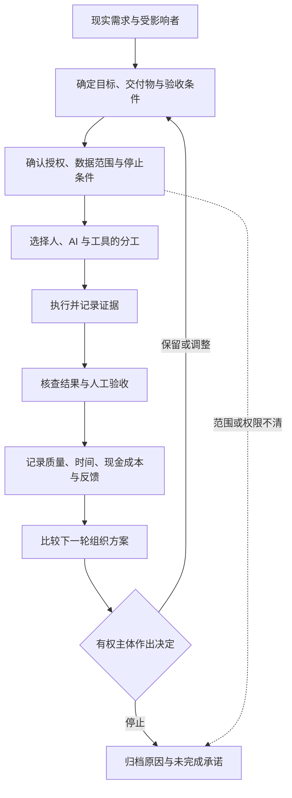

# MAOU：最小自主组织单元

Minimum Autonomous Organizational Unit

MAOU 是我们探索人和 AI 如何共同完成现实业务的一套组织框架。它从一份可验收的活动承诺开始，记录目标、授权、实际行动、成本与反馈，再据此决定下一轮怎样分工。

一个人、一类可替换的 AI 能力，也可以构成最小实验。是否增加 Agent、接入工具或引入合作方，要由任务和反馈决定。

本仓库由 i光整理发布。首版日期：2026-10-29；发布版本：`0.1.0-research`。这是从早期研究资料整理出的公开框架与离线示例，不是当前私有工作台的完整源码，也未完成生产系统验收。

## 为什么做这个项目

我们最早提出的问题是：使用 AI 时，除了表达需求，人还怎样参与目标形成、资源调度和后果判断？

把这个问题放进项目，就会遇到具体的困难：谁能改变交付范围？工具能访问一个账号，是否就有权对外承诺？某个 Agent 失败后，哪些任务该停？输出看起来合格，是否有人验收？节省的时间扣掉审核与维护后，还剩多少？

MAOU 用活动承诺和账本把这些问题放到同一条可追踪的工作链上。我们希望验证这种安排是否有用，也记录它可能增加的管理负担。

## 框架结构



图中是框架设计。仓库内的 Python 示例只实现离线建档、审批标记、事件、重构提案和结果汇总；它不会调度 Agent，也不会对外执行操作。

## 从哪里开始

| 你想了解什么 | 文件 |
| --- | --- |
| MAI、MAOU、G/A/C/F 的定义 | [FRAMEWORK.md](FRAMEWORK.md) |
| 调度、失败隔离、回退与外部副作用 | [ARCHITECTURE.md](ARCHITECTURE.md) |
| 已有示例到底实现了什么 | [IMPLEMENTATION_STATUS.md](IMPLEMENTATION_STATUS.md) |
| 最早的思想怎样演进 | [RESEARCH_HISTORY.md](RESEARCH_HISTORY.md) |
| OpenMOSS 与相关研究的贡献 | [ACKNOWLEDGMENTS.md](ACKNOWLEDGMENTS.md) |
| 怎样做有强基线的对照实验 | [EVALUATION.md](EVALUATION.md) |
| 一个完全虚构的内容制作活动 | [EXAMPLE_ACTIVITY.json](EXAMPLE_ACTIVITY.json) |
| 执行离线账本演示 | [QUICKSTART.md](QUICKSTART.md) |
| 资料来源与代码打包改动 | [PROVENANCE.md](PROVENANCE.md) |
| 使用与转载范围 | [RIGHTS.md](RIGHTS.md) |

## 运行离线示例

Python 3.9+，只用标准库，无需 API Key，无需安装依赖：

```bash
python3 demo_offline.py
python3 -m unittest discover -s . -p 'test_*.py' -v
```

演示数据和数据库在临时目录创建，运行结束清理。示例不会调用模型、发布内容、联系客户或修改合同。测试通过所覆盖的行为与局限见 [VALIDATION.md](VALIDATION.md)。

## 与 OpenMOSS 的关系

感谢邱锡鹏及 OpenMOSS 团队的组织智能研究，为我们后续审视组织层面的知识、权限、责任和反馈提供了重要参照。论文官方关联机构列为 OpenMOSS Team、复旦大学、上海创智学院。详见 [官方论文页面](https://openmoss.ai/blog/en/organizational-intelligence/) 与 [Zenodo 记录](https://zenodo.org/records/20773858)。

MAOU 是我们在小规模业务场景中的工作定义和工程探索；本项目与 OpenMOSS 无官方隶属、联合研发或背书关系。我们不主张首创组织智能，也不把已有文献的思想计为自己的成果。具体启发、差异与来源写在 [致谢与相关研究](ACKNOWLEDGMENTS.md)。

## 适用场景

可用于整理一人或小团队的内容制作、研究交付、FDE 项目及跨工具协作。FDE 是可能采用这套方法的一类实践；已有的 FDE、Agent 与组织治理方法各有独立来源。

先在虚构数据或已获授权的低风险活动中试验。若普通任务清单与成熟工作流已能解决问题，应把它们作为有竞争力的基线。

## English abstract

MAOU is a working framework for small human–AI organizations. It follows activity commitments, authority, actual control, evidence, costs, and feedback, then records decisions about how work should be organized next. This research release includes documentation and a standard-library Python ledger recovered from an early internal archive. It does not implement an autonomous multi-agent runtime. Organizational Intelligence research by Xipeng Qiu and the OpenMOSS team is acknowledged as an important subsequent reference, without implying affiliation or endorsement.

Contributions should distinguish hypotheses, implementations and measured results. Please use synthetic examples and omit private conversations, credentials and customer data. The initial publication does not yet grant an open-source license; see [RIGHTS.md](RIGHTS.md).
